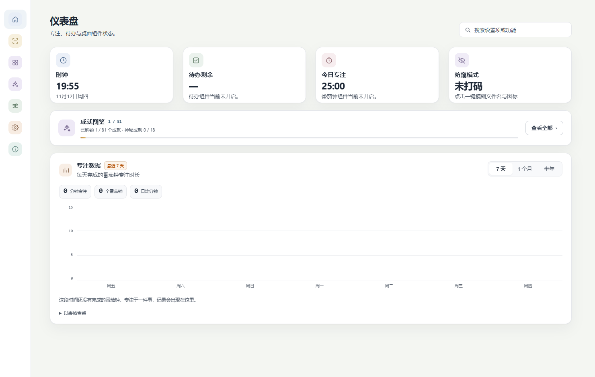
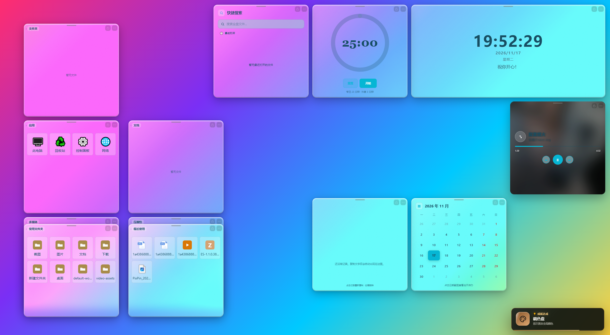
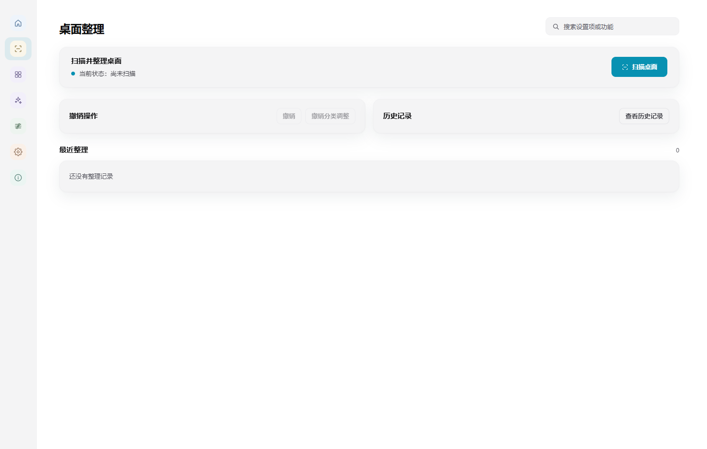
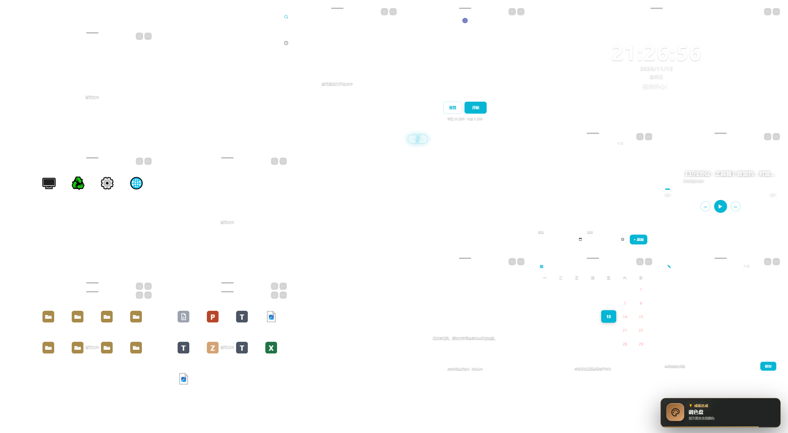
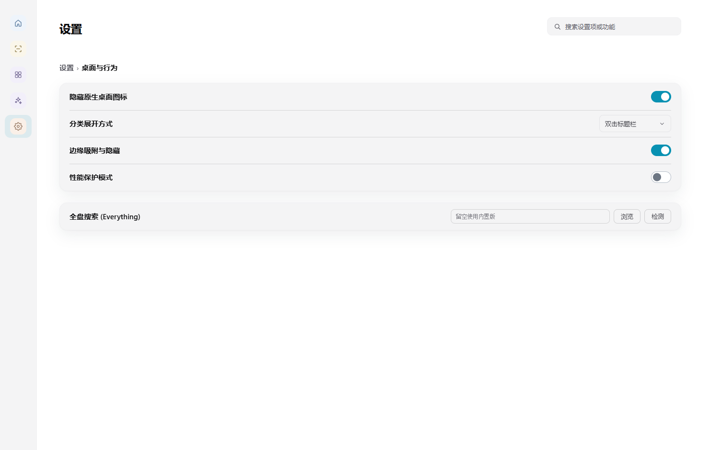

# 方寸格 · Within Cubes v0.9.1

> 把桌面整理成清晰、安静、随时可用的方寸之地。

**Windows x64 · Electron 44 · MIT 开源 · 全本地、零遥测**

## 一句话

一个"只登记归属、不搬动文件"的桌面整理器。文件永远留在 `Desktop` 原路径，资源管理器和其他软件看到的都是原样；方寸格只记录每个文件属于哪个分类，再把它们渲染进嵌在桌面壁纸与图标之间的透明组件里。撤销和回档删除的也只是归属记录，文件本身毫发无损。

## 截图

| 仪表盘 | 桌面组件层（液态玻璃） |
|:---:|:---:|
|  |  |

| Dock 栏 | 桌面整理 |
|:---:|:---:|
|  |  |

| 完全透明模式 | 设置 |
|:---:|:---:|
|  |  |

## 核心能力

### 文件与分类

- 扫描桌面生成预览，确认后仅写归属记录；一次整理为一个批次，保留最近 10 次，支持撤销与按批次回档。
- 7 个分类：文件夹、应用/快捷方式、文档、图片音频等多媒体、压缩包、常用文件夹、最近使用。后两类直接读 Windows 系统列表。
- 标签组：拖一个分类标题到另一张卡片合并为标签页，可横向滚动、再拆分回独立组件。
- 原生 Win11 磨砂右键菜单；Ctrl+左键跨分类多选、框选、批量拖入；拖到文件夹真正移动、拖到回收站进入系统回收站、按住 Alt 可拖到微信等外部程序。
- 回收站、此电脑、控制面板、网络作为虚拟图标固定在"应用"分类。

### 9 个桌面组件（时钟 / 音乐 / 随手记 / 待办 / 日历 / 番茄钟 / 快速收纳 / 剪贴板历史 / 快速搜索）

- 统一在 WorkerW 透明层，可拖动、四边四角缩放、锁定、重命名、折叠，位置尺寸持久化。
- 时钟三种排版，字体字号颜色独立可调。
- 音乐只读 Windows 媒体会话（SMTC），支持歌词同步与 3D 翻转歌词页；播放时其余挂件自动退到背景。
- 随手记支持多行草稿与图文卡片；待办可勾选、拖到日历排期、导入 Outlook/.ics、导出 .txt；日历点击日期 3D 翻转看当天待办。
- 番茄钟 25/5 分钟循环，圆环拖动调时（1–120 分钟），拖入文件按类型估算时长，专注时其余组件降透明，仪表盘有 7 天/1 月/半年专注统计。
- 快速收纳只登记引用不移动文件；剪贴板历史默认关闭、只存内存、保留最近 10 条；快速搜索覆盖桌面/分类/收纳的文件名与路径。
- 另有可选玩法：赛博桌宠、空间胶囊。

### 场景预设（v0.9 新增）

专注 / 工作 / 娱乐 / 极简四套预设 + 自定义场景。专注模式一键隐藏分类、随手记、剪贴板、Dock、桌宠与胶囊，只留时钟和番茄钟，切暗色界面与极客黑组件，并自动启动番茄钟。

### Dock 栏

独立置顶窗口，常驻图标可拖拽排序，底部/左侧/右侧三档位置，缩放 1.0–2.0、图标 40–80px，默认关闭。

### 外观与主题

- 主界面主题：暗黑 / 纯白 / Arc 渐变；组件 6 套成套主题：白 / 黑 / 暖 / 青 / 紫 / 莫兰迪。
- 背景材质四档：半透明 / 液态玻璃 / 纯色 / 完全透明。液态玻璃采用强折射与三层高光暗边；完全透明只留文字与拖动条。
- 智能节律：全离线按时间变色（早绿、午后橙、傍晚暖橙、夜间紫），内置二十四节气与中国法定节假日。
- 跟随壁纸明暗自动切换深墨/白字、音乐封面背景、Ctrl+滚轮 3D 景深、30 天未动文件灰度化、性能保护模式。

### 效率与系统

- 全局快捷键：`Ctrl+Alt+S` 搜索、`Ctrl+Alt+F` 专注、`Ctrl+Alt+V` 访客防窥、`Ctrl+Alt+B` 仪表盘，可录制、冲突提示、前台全屏自动注销。
- 81 个成就，达成时 Steam 风格弹窗，设置页有完整图鉴。
- 系统托盘：快速整理、专注、呼出搜索、退出；关窗最小化到托盘。
- 多显示器：桌面层覆盖所有显示器并集，组件跨屏连续拖动，显示器变化后自动重算边界。
- 空白区鼠标穿透到原生桌面（可框选系统图标）；文本输入时桥接键盘与中文输入法到 WorkerW 层。

### 布局分享（v0.9 新增）

"设置 → 布局与分享"可生成文本分享码，粘贴即可还原布局。分享码只带主题、背景、时钟、组件位置尺寸等白名单字段，待办文字、剪贴板历史、文件路径不会带出；背景图以 288px 缩略图随码携带，超长降级为只记文件名。导入只覆盖布局，本地待办、分类、Dock、缩放不动。

### 更新与数据

- "设置 → 关于"提供原地展开的更新面板：检查、发现新版、下载进度、重启安装四态，支持失败重试与自动检查开关。
- 全部数据在本机 `userData/`，无数据库、无云端、无账号；除检查更新外不联网，无遥测、无埋点。
- 6 种界面语言，布局 `.zc` 导入导出，旧版目录首次启动自动迁移并备份。

## 下载与安装

安装包因超过 GitHub 的 100 MB 单文件限制，不作为仓库文件存放，请到本仓库的 **[Releases 页面](../../releases)** 下载 `WithinCubes-Setup-0.9.1-x64.exe`（约 139 MB）。

- 仅支持 **Windows x64**。
- 从 v0.8.x 升级直接运行安装包即可，用户数据（归属记录、待办、随手记、组件布局）全部保留。
- 首次启动会播放 8 步聚光灯引导，带你在桌面层走一遍。
- 应用内自动更新需要把 exe、blockmap、latest.yml 三个文件放在同一个 Release 中。

## 隐私

除检查更新外不联网；无遥测、无埋点、无账号。所有数据留在本机 `userData/`。

## 许可

MIT，见 [LICENSE](LICENSE)。
